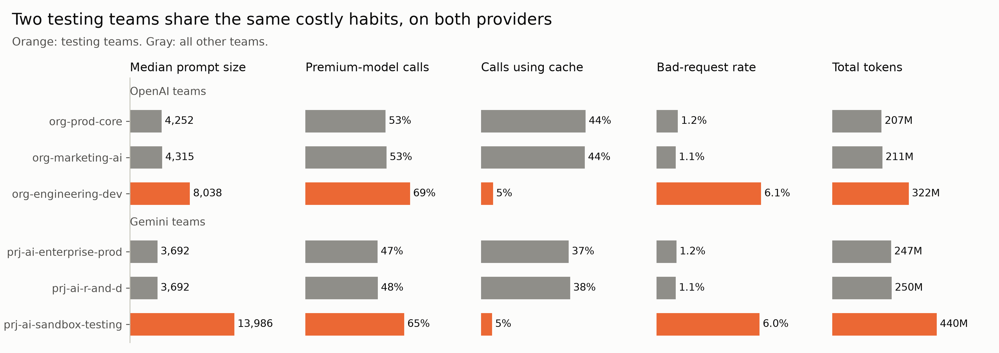

# The Cost of Scarcity

**Why this matters:** AI costs keep growing while budgets stay fixed, so someone will have to decide which requests, and which teams, get cut off. This project tests six rules for making that decision.

**For CMU Computing Services:** how should we share next semester's AI budget? See the interactive story (`figures/story.html`, live at https://cost-of-scarcity.vercel.app) and dashboard (`figures/dashboard.html`, https://cost-of-scarcity.vercel.app/dashboard).

**Who keeps access to AI when the budget runs short?** This CMU Student IronViz
Fall 2026 project examines that question through synthetic OpenAI and Gemini
telemetry, modeled inference costs, and six allocation policies. It connects
usage analysis with an auditable simulator to show how a policy can increase
completed requests while shifting access between teams—or leave money unused
while requests are denied.

## The problem

An institution has a shared AI budget and teams with different request volumes,
model choices, and costs. Serving requests in arrival order is simple. Fixed team
allocations protect entitlements. Sharing, pacing, and cost thresholds make
different compromises. We compare **fully completed requests, access across
operational teams, and budget utilization**.

## The dataset

| Scope | Records |
|---|---:|
| Synthetic API telemetry, October 1–30, 2026 | 202,650 |
| Eligible successful requests | 192,847 |
| Operational tenants | 6 |
| Historical comparison: training requests | 38,569 |
| Historical comparison: evaluation requests | 154,278 |

These are synthetic competition records, **not actual CMU billing**. Full-month
modeled reference expenditure is **$5,710.576193**; the evaluation reference is
**$4,398.736885**. Neither is a verified invoice.

## Our approach

1. **Reconstruct cost:** price uncached input, cached input, and output separately.
2. **Compare allocation choices:** FCFS, equal quotas, training-calibrated quotas,
   adaptive sharing, pacing, and a cost threshold.
3. **Account explicitly:** reserve before execution, settle modeled costs, and
   distinguish completed, truncated, and rejected requests.
4. **Test stability:** run all six policies on 49 simulated months, each about
   5,000 October requests resampled in 12-hour blocks, at a 70% budget.

## What the October replay shows

We replayed all **154,278 evaluation requests** (October 7–30) under six rules at
50%, 70%, 85% and 100% budgets. At a modeled **70% budget ($3,079.12)**:

| Policy | Fully completed requests | Unused modeled budget |
|---|---:|---:|
| First come, first served | 42,573 | <$0.01 |
| Equal quotas | 36,641 | $741.27 |
| Training-calibrated quotas | 44,699 | $101.37 |
| Adaptive sharing | 45,768 | $78.57 |
| Pacing | 46,217 | <$0.01 |
| Cost threshold | 47,384 | <$0.01 |

- **Equal budgets do not guarantee equal access.** Equal quotas leave $741.27
  unused while rejecting 33,745 requests.
- **Aggregate gains can conceal a team loss.** Adaptive adds 3,195 completions
  over FCFS, while engineering-dev loses 1,900.
- **A small request class dominates modeled cost.** Across the eligible month,
  o1-preview accounts for 5.33% of calls and 50.73% of estimated expenditure.

The policy table shows **results from the October replay**. The replay uses a
1,024-token output limit and reserves an average answer length, so many admitted
requests are cut short even at a 100% budget. The 49 simulated months use an
8,192-token limit, so their completion rates are higher.

**The answer holds across 49 simulated months.** Cost threshold completes a median
**+12.3 percentage points** more requests than first come, first served (+11.7 to
+12.7 in 90% of months) and spend pacing **+10.2 points**; both do better in all 49
months. Adaptive sharing gains +4.9 points but lowers engineering-dev by 6.4 points
in every month. Equal quotas is close to first come, first served overall (+0.3
points, better in 31 of 49) while cutting engineering-dev by 15.6 points.

## Why it matters

A policy can serve more requests by favoring cheaper executions, improve some
teams' access at another's expense, or protect allocations that remain unused.
An institutional decision needs more than one completion-count ranking. Our
results make those competing objectives visible.

## Results and visualizations

**Download individual CSVs from GitHub and build charts without running Python.**
Start with the [visualization handoff](VISUALIZATION_HANDOFF.md) for exact columns,
chart suggestions, joins, and caveats.

| Chart-ready dataset | What it supports |
|---|---|
| [Policy × budget](results/presentation/policy_budget_summary.csv) | All 24 historical runs: outcomes, spending, unused money, FCFS differences |
| [Tenant trade-offs at 70%](results/presentation/tenant_tradeoffs_70pct.csv) | Winners and losers across six tenants and policies |
| [Bootstrap methods at 70%](results/presentation/bootstrap_methods_70pct.csv) | Separate replay and single-resample probes by method |
| [Monte Carlo policy summary](results/presentation/monte_carlo/policy_summary.csv) | Six policies over 49 simulated months: completion, rejection, truncation |
| [Monte Carlo paired effects](results/presentation/monte_carlo/paired_effects.csv) | Each policy minus first come, first served: median, ranges, wins |
| [Monte Carlo team outcomes](results/presentation/monte_carlo/tenant_outcomes.csv) | Each team's change under each policy across the 49 months |
| [Monte Carlo runs](results/presentation/monte_carlo/replicate_results.csv) | All 300 runs: replay plus 49 resamples for six policies |

See the [data dictionary](results/presentation/data_dictionary.md) and
[source provenance](results/presentation/provenance.json). Original historical
exports remain unchanged in [results/canonical](results/canonical/).

The team's [static figures](figures/static/) and
[animated charts](figures/animated/animated_charts.html) preserve the original
presentation. Their simulation panels use the legacy pipeline, not corrected
modular results. A descriptive preview:



## Monte Carlo: 49 simulated months

To check whether the replay's ranking holds in a slightly different month, we
built **49 simulated months**. Each one samples about 5,000 October requests in
proportion to teams, models and dates, resamples them in 12-hour blocks, and runs
all six policies on the same requests at a 70% budget with the updated simulator.
Cost threshold > spend pacing > adaptive sharing held in all 49 months, and all
three beat first come, first served every time. Equal quotas beat it in 31 months
and lost in 18. Ranges describe how much results move between months; they are
not formal confidence intervals. Details are in the
[study README](results/presentation/monte_carlo/README.md).

An earlier [fictional pilot](documentation/MONTE_CARLO.md) (29 draws, three policies) tested the method.
A [small mechanism investigation](documentation/PACING_INVESTIGATION.md) shows
that Pacing also selects among request costs: it drops requests exceeding the
current allowance rather than queuing them. More completions do not imply
more useful output.

## Repository guide

| Path | Purpose |
|---|---|
| `results/presentation/` | Chart-ready CSVs, dictionary and provenance |
| `results/canonical/` | Preserved historical outputs and configuration |
| `ironviz_f26/` | Modular budget simulation engine |
| `src/`, `config/` | Original preparation/analysis and pricing assumptions |
| `charts/`, `figures/` | Preserved visualization code and assets |
| `documentation/` | Methodology, contracts, validation and investigations |
| `tests/`, `tools/` | Safe checks and reusable utilities |
| `outputs/`, `data/raw/` | Ignored local experiment artifacts and raw inputs |

## Run the code safely

With Python 3.11+ in a virtual environment:

```bash
python -m pip install -e .
python -m pytest -q
python -m ironviz_f26 --help
```

Tests need `pyarrow`, which `requirements.txt` and `pyproject.toml` already list
(`python -m pip install -r requirements.txt`).

### Which command makes which result

| Result | Command |
|---|---|
| Cleaned requests and usage summaries (`results/clean_requests.csv`, `results/analysis_*.csv`, `results/settings.json`) and the original static/animated figures | `bash run_all.sh` (needs the two raw CSVs in `data/raw/`; this is the original four-rule pipeline) |
| Simulator input built from the cleaned requests | `python tools/adapt_reference.py` (writes `outputs/canonical_reference/`) |
| October replay: six rules × four budgets (`results/canonical/policies/`) | `python -m ironviz_f26 run-experiments --input outputs/canonical_reference/canonical_requests.csv --price-catalog outputs/canonical_reference/price_catalog_micro_usd.json --output-dir outputs/authoritative_policies --budget-fractions 0.5,0.7,0.85,1.0 --replicates 1 --seed 731 --demand-imbalance 1.0 --routing-eligibility 0.0`, then `python tools/curate_results.py` (settings from `results/canonical/policies/scenario_metadata.json`; the original command line was not saved) |
| 49 simulated months (`results/presentation/monte_carlo/`) | `python tools/run_october_monte_carlo.py prepare`, then `python tools/run_october_monte_carlo.py run --stage main --replicates 50` (replay plus 49), then `python tools/summarize_october_monte_carlo.py` |
| Chart-ready tables (`results/presentation/*.csv`) | `python tools/build_presentation.py` (reads saved tables only; runs no simulation) |
| Dashboard and story (`figures/dashboard.html`, `figures/story.html`) | `python charts/make_dashboard.py results charts/dashboard_template.html figures/dashboard.html` and `python charts/make_story.py results charts/story_template.html figures/story.html` |

The full replay and Monte Carlo runs are slow; the saved results are already in
the repository, so the last two rows are all you need to rebuild the visuals.

## Methodology and limitations

See the [methodology](documentation/METHODOLOGY.md),
[data contract](documentation/DATA_CONTRACT.md), and
[correctness validation](documentation/VALIDATION.md). Historical experiments
preceded repairs and were not regenerated. Historical bootstrap probes have
one resample per method. Price effective dates, task utility and quality-preserving
model substitutions are unverified. Tenant disparity concerns operational groups,
not demographic fairness.

Raw files remain untracked and protected locally; some raw data already exists
in upstream Git history, which this work does not rewrite. Original teammate work
and attribution remain preserved. Analysis and engineering used AI assistance;
interpretations require human review.
